# 🏗️ PROJECT ARCHITECTURE MAP (MOC)

> **PROPÓSITO:** Mapa estructural de topología, capas de software, middlewares y flujo de datos de la plataforma **Liseth // JARVIS AI Core**.

---

## 📐 TOPOLOGÍA GENERAL DEL SISTEMA

```mermaid
graph TD
    User["👤 Usuario / Navegador Web / Dispositivo Móvil"] -->|HTTPS / WSS / Web NFC| Frontend["🖥️ Cyber-HUD UI (Vanilla JS + Three.js Orb + Audio Web API)"]
    
    subgraph "Capas de Frontend"
        Frontend --> HUD48["48 Módulos HUD"]
        Frontend --> Orb["Núcleo 3D Partículas (Three.js)"]
        Frontend --> NFCHub["NFC Hub & Reader/Writer"]
        Frontend --> Onboarding["Onboarding Gate Modal"]
    end
    
    Frontend -->|REST API / JSON| Middleware["🛡️ Pipeline Middleware FastAPI (CORS, RateLimiting, Auth, BOLA)"]
    
    subgraph "Backend FastAPI (Puerto 8000 / 3000)"
        Middleware --> Routers["FastAPI Routers"]
        Routers --> AuthRouter["/api/auth (Login, Register, Logout)"]
        Routers --> SaasRouter["/api/saas (Billing, Plans, Referrals, Gateways)"]
        Routers --> BrainRouter["/api/brain (Chat, Soul, Memory, Routing)"]
        Routers --> NFCRouter["/api/nfc (NDEF Cards, P2P Transfers)"]
        
        Routers --> Services["Capa de Servicios"]
        Services --> SaasService["SaaS & Billing Service"]
        Services --> BrainService["Multi-Brain Orchestrator"]
        Services --> AuthService["PBKDF2/scrypt Security Service"]
        Services --> TokenOptService["Token & Prompt Optimizer"]
        Services --> MemoryService["ChromaDB & Context Memory"]
    end
    
    subgraph "Persistencia & Datos"
        Services --> DBEngine["SQLAlchemy Async + aiosqlite"]
        DBEngine --> SQLite["SQLite DB (data/app.db - Modo WAL, 18 Índices Compuestos)"]
        Services --> Chroma["ChromaDB Vector Store (data/chroma/)"]
    end
    
    subgraph "Ecosistema Externo de Inteligencia Artificial"
        BrainService --> Gemini["Google Gemini 2.5 / 3.8 Flash (Multimodal, Long-Context)"]
        BrainService --> Groq["Groq Cloud (LLaMA 3.3 70B Versatile, Baja Latencia)"]
        BrainService --> Anthropic["Anthropic Claude 3.5 Sonnet (Razonamiento Complejo)"]
        BrainService --> OpenAI["OpenAI GPT-4o (Fallback de Respaldo)"]
    end
    
    subgraph "Pasarelas de Pago & Servicios Cloud"
        SaasService --> BreB["Bre-B Bancario (@NEQUISAN243100)"]
        SaasService --> Nequi["Nequi Oficial (3122376474)"]
        SaasService --> Stripe["Stripe Billing Engine"]
        SaasService --> Wompi["Wompi Colombia"]
        SaasService --> Firebase["Google Firebase Auth & Admin SDK"]
    end
```

---

## 🧩 DESGLOSE DE COMPONENTES POR CAPAS

### 1. Capa de Presentación (Frontend)
- **Tecnología:** Vanilla ECMAScript 2024, CSS3 Grid/Flexbox Cyberpunk HUD, Three.js r128 (WebGL Particle AI Orb).
- **Controlador Principal:** [index.html](file:///c:/Users/Usuario/Desktop/MI%20LISEHT/index.html) (9,250 líneas unificadas con paridad criptográfica en `jarvis.html` y `app/static/index.html`).
- **Arquitectura de Interfaz:** Ver [[cyber_hud_architecture]], [[threejs_particle_orb]], [[audio_visualizer]].

### 2. Capa de Enrutamiento y Middleware (FastAPI)
- **Punto de Entrada:** [app/main.py](file:///c:/Users/Usuario/Desktop/MI%20LISEHT/app/main.py)
- **Middlewares Activos:**
  - `SecurityHeadersMiddleware`: Previene clickjacking (`X-Frame-Options: DENY`), inyección XSS (`X-Content-Type-Options: nosniff`) y fuerza HTTPS.
  - `RateLimitMiddleware`: Ventana deslizante para mitigar ataques de denegación de servicio (DoS) y fuerza bruta en `/api/auth/login`.
  - `ApiAuthMiddleware`: Autenticación por token Bearer en cabecera HTTP, verificación de listas negras y aislamiento de tenant.
  - Ver [[fastapi_architecture]], [[auth_defense]].

### 3. Capa de Lógica de Negocio (Servicios)
- **SaaS & Monetización:** [app/services/saas_service.py](file:///c:/Users/Usuario/Desktop/MI%20LISEHT/app/services/saas_service.py) — Gestión de suscripciones, ledger contable inmutable, cifrado AES-256-GCM de API keys, onboarding gate y motor anti-fraude de referidos.
- **Orquestador Multi-Cerebro:** [app/services/brain_service.py](file:///c:/Users/Usuario/Desktop/MI%20LISEHT/app/services/brain_service.py) — Enrutamiento heurístico de consultas entre Gemini, Groq, Claude y OpenAI.
- Ver [[saas_engine]], [[brain_service]], [[token_optimization]].

### 4. Capa de Persistencia de Datos
- **Motor de Base de Datos:** SQLite 3 operando en modo WAL (`Write-Ahead Logging`), `synchronous=NORMAL` y `busy_timeout=15000`.
- **Modelos de Datos:** [app/models/saas.py](file:///c:/Users/Usuario/Desktop/MI%20LISEHT/app/models/saas.py) (14 tablas normalizadas).
- **Optimización de Índices:** 18 índices compuestos que aceleran consultas BOLA y búsquedas por tenant a menos de 2 ms.
- Ver [[database_schema]], [[indexing_and_wal]], [[credit_ledger]].

---

## 🔄 DECISIONES ARQUITECTÓNICAS ASOCIADAS (ADRs)
- [[ADR-001-Multi-Brain-Cascade]] — Cascada híbrida de cerebros para minimizar costes y latencia.
- [[ADR-002-SQLite-WAL-Indexes]] — Persistencia SQLite con WAL y 18 índices compuestos para SaaS concurrente.
- [[ADR-003-AES256GCM-Tenant-Keys]] — Cifrado autenticado AES-256-GCM para llaves de IA por usuario.
- [[ADR-004-Immutable-Credit-Ledger]] — Libro contable inmutable de doble entrada para auditoría financiera.
- [[ADR-005-Onboarding-Gate]] — Barrera obligatoria de activación con cuenta Firebase y plan comercial.
- [[ADR-006-Web-NFC-Hardware]] — Integración hardware Web NFC para tarjetas de presentación e intercambio P2P.
