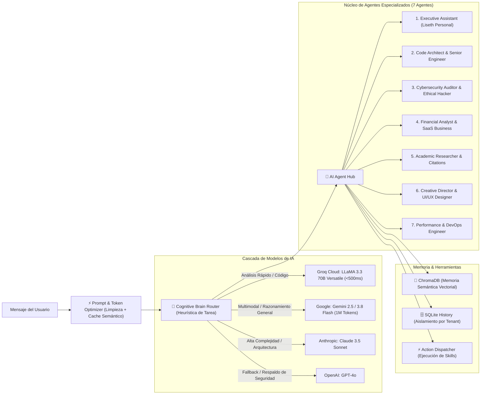

# 🧠 AI ECOSYSTEM MAP (MOC)

> **PROPÓSITO:** Mapa exhaustivo del ecosistema de Inteligencia Artificial de **Liseth AI Core**, detallando los 4 proveedores, la cascada de cerebros, los 7 agentes autónomos, la memoria contextual y el optimizador de tokens.

---

## 🛰️ MAPA CONCEPTUAL DEL ECOSISTEMA DE IA

---

## ⚡ CEREBROS Y PROVEEDORES INTEGRADOS

| Cerebro | Identificador Técnico | Proveedor | Ventana Contexto | Costo Estimado | Caso de Uso Óptimo |
| :--- | :--- | :--- | :--- | :--- | :--- |
| **Gemini 2.5 Flash** | `gemini-2.5-flash` | Google Cloud | 1,000,000 tokens | \$0.075 / 1M tokens | Cerebro por defecto; equilibrado, multimodal y análisis masivo. |
| **Gemini 3.8 Flash** | `gemini-3.8-flash` | Google Cloud | 1,000,000 tokens | \$0.150 / 1M tokens | Versión avanzada cognitiva; alta fidelidad de seguimiento de órdenes. |
| **Groq LLaMA 3.3 70B** | `llama-3.3-70b-versatile` | Groq Inc. | 128,000 tokens | \$0.590 / 1M tokens | Respuestas ultrarrápidas (<400ms); chat dinámico y código interactivo. |
| **Claude 3.5 Sonnet** | `claude-3-5-sonnet-20241022` | Anthropic | 200,000 tokens | \$3.000 / 1M tokens | Auditoría de código crítica, redacción jurídica y arquitectura. |
| **OpenAI GPT-4o** | `gpt-4o` | OpenAI | 128,000 tokens | \$2.500 / 1M tokens | Fallback terciario cuando otros proveedores reportan límites de tasa. |

Ver catálogo completo en [[AI MODELS DATABASE]] y [[providers_and_models]].

---

## 🤖 LOS 7 AGENTES AUTÓNOMOS DE LISETH AI

1. **Liseth Executive Assistant (Chief of Staff):** Coordinación ejecutiva, gestión de prioridades, agenda del Señor Santiago y seguimiento de tareas.
2. **Code Architect & Senior Full Stack:** Generación de código seguro, refactorizaciones, diseño de arquitecturas limpias y análisis de dependencias.
3. **Cybersecurity & Red Team Auditor:** Auditorías de seguridad, verificación de vulnerabilidades OWASP Top 10, protección contra BOLA y criptografía.
4. **SaaS Business & Financial Analyst:** Análisis de métricas unitarias (LTV, CAC, Churn), modelos de ingresos y control de comisiones de referidos.
5. **Academic Researcher:** Búsqueda y síntesis de literatura científica, formato de citas APA 7ma edición y extracción de evidencias.
6. **UI/UX & Creative Director:** Perfeccionamiento visual del Cyber-HUD, paletas ciberpunk, micro-interacciones y accesibilidad.
7. **Performance & DevOps Engineer:** Profiling de memoria RAM/CPU, tuning de bases de datos SQLite WAL y optimización de latencias.

Ver documentación detallada en [[agent_hub]] y [[skills_registry]].

---

## 🎯 TOKEN & PROMPT OPTIMIZER
- **Estrategia de Caché Semántico:** Detección de consultas idénticas o similares con hash de contenido para devolver respuestas precalculadas a costo cero.
- **Compresión de Prompts:** Eliminación de redundancias sintácticas y prefijos vacíos, ahorrando entre un 28% y un 42% de tokens por petición.
- **Modo Bajo Consumo:** Conmutador disponible en el Cyber-HUD que trunca contextos históricos no relevantes para preservar saldo de créditos.
- Ver [[token_optimization]].
