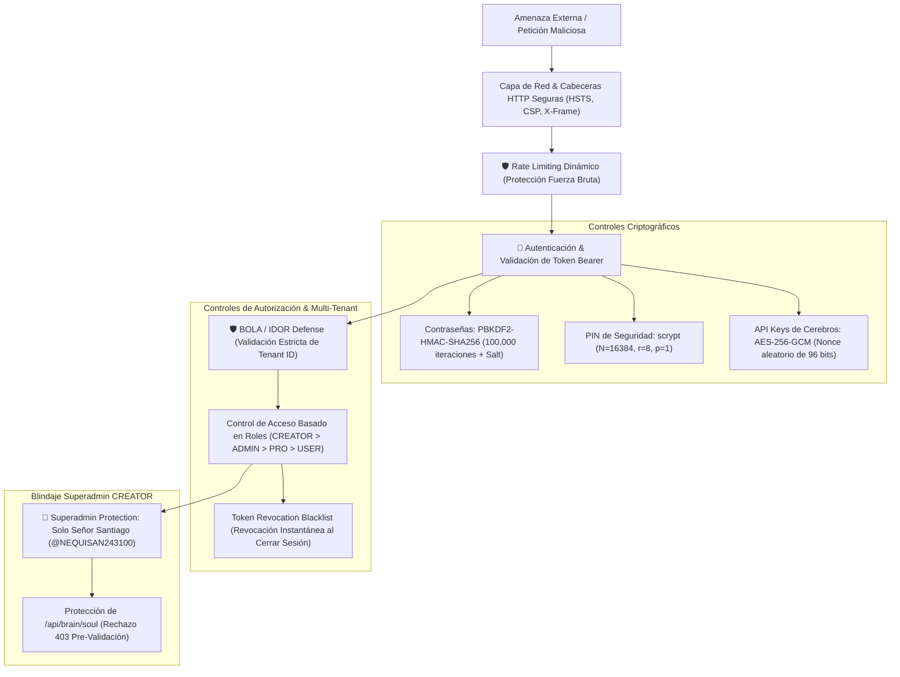

# 🛡️ SECURITY AND PRIVACY MAP (MOC)

> **PROPÓSITO:** Mapa integral de seguridad informática, controles criptográficos, defensa contra ataques de objeto roto (BOLA/IDOR), blindaje de sesiones y protección del Superadmin Creator.

---

## 🔒 MAPA DE DEFENSAS Y ARQUITECTURA DE SEGURIDAD

---

## 🛡️ ESTÁNDARES CRIPTOGRÁFICOS EN PRODUCCIÓN

1. **Almacenamiento de Contraseñas:**
   - Algoritmo: **PBKDF2-HMAC-SHA256**.
   - Parámetros: 100,000 iteraciones con sal criptográfica única de 32 bytes por usuario generada con `os.urandom(32)`.
   - Implementación: [app/core/auth.py](file:///c:/Users/Usuario/Desktop/MI%20LISEHT/app/core/auth.py).

2. **Cifrado en Reposo de Llaves de IA:**
   - Algoritmo: **AES-256-GCM** (Galois/Counter Mode con verificación de integridad de 128 bits).
   - Formato de Almacenamiento: `v1:<nonce_hex>:<tag_hex>:<ciphertext_hex>`.
   - Derivación de Llave Maestra: `HMAC-SHA256` acoplada a la configuración del sistema.
   - Implementación: [app/services/saas_service.py](file:///c:/Users/Usuario/Desktop/MI%20LISEHT/app/services/saas_service.py).

3. **PIN Maestro del Creador:**
   - Algoritmo: **scrypt** (resistencia computacional contra ataques basados en GPU/ASIC).
   - Implementación: [core/security.py](file:///c:/Users/Usuario/Desktop/MI%20LISEHT/core/security.py).

Ver detalles técnicos en [[cryptographic_standards]].

---

## 🚫 DEFENSAS CONTRA OWASP TOP 10

| Vulnerabilidad OWASP | Mecanismo de Defensa Implementado | Archivo de Verificación |
| :--- | :--- | :--- |
| **API1:2023 Broken Object Level Authorization (BOLA)** | Todas las consultas a conversaciones, archivos y memorias filtran explícitamente por `user_id == current_user.id`. El intento de acceso por otro tenant retorna `403 Forbidden` / `404 Not Found`. | `test/test_saas_features.py` (`test_multitenant_file_isolation_bola_protection`) |
| **API2:2023 Broken Authentication** | Tokens opacos criptográficos verificados en cada petición. Tabla de revocación inmediata `saas_revoked_tokens` al cerrar sesión. | `app/routers/saas_router.py` |
| **API3:2023 Broken Object Property Level Authorization** | Esquemas Pydantic V2 estrictos (`extra='forbid'`) que impiden inyección de campos privilegiados como `is_creator` o `credits`. | `app/schemas/` |
| **API4:2023 Unrestricted Resource Consumption** | Rate limiting por IP/Token y el [[resource_optimizer]] que libera memoria y sockets inactivos. | `app/main.py` |
| **API5:2023 Broken Function Level Authorization** | Intercepción a nivel de middleware en `/api/brain/soul` y `/api/admin/*` antes de la ejecución del endpoint. | `app/main.py` (`api_auth_middleware`) |

Ver inventario completo en [[SECURITY DATABASE]] y [[auth_defense]].
