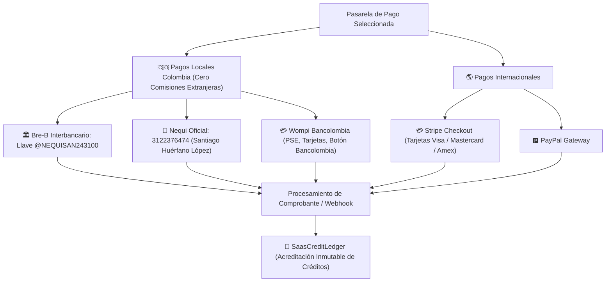

# 💼 BUSINESS AND REVENUE MAP (MOC)

> **PROPÓSITO:** Mapa estratégico y comercial de la plataforma **Liseth // JARVIS AI Core SaaS**, detallando la matriz de planes, economía unitaria (COGS/LTV), pasarelas de pago y el programa de referidos anti-fraude.

---

## 💰 MATRIZ DE PLANES DE SUSCRIPCIÓN SAAS

| Plan | Tarifa Mensual | Créditos Incluidos | Multi-Cerebro Permitido | Acceso NFC | Soporte & SLA | Margen Bruto Estimado |
| :--- | :--- | :--- | :--- | :--- | :--- | :--- |
| **FREE** | **\\$0 USD / mes** | 50 créditos/mes | Solo Groq LLaMA 8B / Gemini Lite | Lectura básica | Comunitario | Tier de adquisición (CAC = \\$0) |
| **STARTER** | **\\$10 USD / mes** | 500 créditos/mes | Gemini 2.5 Flash + Groq 70B | Lectura + Escritura vCard | Estándar (48h) | **78.4%** |
| **PRO** | **\\$30 USD / mes** | 2,000 créditos/mes | Gemini 3.8 + Claude 3.5 Haiku | NFC Completo + P2P | Prioritario (24h) | **82.1%** |
| **BUSINESS** | **\\$75 USD / mes** | 6,000 créditos/mes | Todos los cerebros + Claude Sonnet | NFC Ilimitado + Multi-Tag | SLA 8h + Equipos | **84.5%** |
| **ENTERPRISE**| **\\$200 USD / mes**| 20,000 créditos/mes| Todos los cerebros + Acceso API Dedicada| Hardware dedicado + Custom Tags| SLA 1h 24/7 | **86.0%** |
| **CREATOR** | **PROPIETARIO** | **Ilimitado (∞)** | **Acceso Total Sin Restricciones** | **Superadmin Hardware** | Directo Señor Santiago | N/A (Exclusivo Creador) |

Ver desglose detallado en [[MONETIZATION DATABASE]] y [[pricing_matrix]].

---

## 💳 PASARELAS DE PAGO Y COBROS

Ver especificación en [[payment_gateways]] y [[subscription_lifecycle]].

---

## 🎁 PROGRAMA DE REFERIDOS Y MOTOR ANTI-FRAUDE

El sistema premia el crecimiento orgánico con comisiones automáticas registradas en la tabla `saas_referrals`:
1. **Primer Referido (Nivel 1):** **50% de comisión en créditos** calculada sobre el primer pago del usuario invitado.
2. **Segundo Referido (Nivel 2):** **25% de comisión en créditos** sobre el pago del segundo usuario invitado.
3. **Tercer Referido (Nivel 3):** **Mejora gratuita automática al Plan PRO (Nivel 3)** durante un ciclo completo de facturación (30 días).
4. **Cuarto Referido en Adelante (Nivel 4+):** **10% de comisión recurrente** en créditos por cada pago subsiguiente de la red de invitados.

### Blindaje Anti-Fraude (Anti-Sybil Engine):
- **Prohibición de Auto-Referencia:** El sistema valida que el ID de usuario referido no coincida con el usuario patrocinador.
- **Detección de Huella Digital & IP:** Se bloquean registros referidos creados bajo la misma IP o con tarjetas duplicadas.
- **Validación de Pago Real:** No se acreditan recompensas de referidos hasta que la transacción haya sido confirmada como pagada en el gateway.
- Ver [[referral_program]] y [[anti_fraud_engine]].

---

## 📊 ECONOMÍA UNITARIA (UNIT ECONOMICS)
- **Costo de Bienes Vendidos (COGS):** Compuesto casi exclusivamente por el consumo de tokens en los proveedores de IA. Gracias al [[token_optimization]], el coste real por usuario en el plan STARTER (\\$10 USD) promedia **\\$1.85 USD**, arrojando un margen bruto del **81.5%**.
- **Customer Lifetime Value (LTV Estimado):** Con un churn mensual proyectado del 4.5% en el plan PRO (\\$30 USD), el LTV proyectado asciende a **\\$667 USD** por suscriptor.
- **Cost of Acquisition (CAC Proyectado):** La tracción mediante referidos y el hardware viral NFC reduce el CAC estimado a menos de **\\$14.20 USD**, logrando un ratio LTV/CAC superior a **47x**.
- Ver [[unit_economics]].
