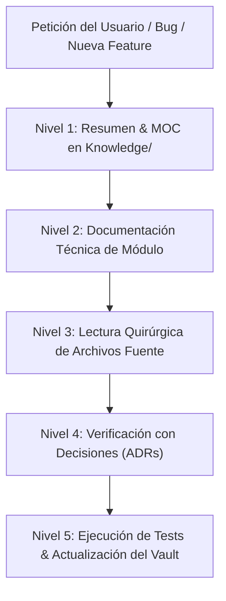

# 🔍 PROTOCOLO DE RECUPERACIÓN PROGRESIVA PARA ANTIGRAVITY

> **DIRECTIVA CRÍTICA:** Antigravity y cualquier agente asistente DEBEN seguir este protocolo de 5 niveles para interactuar con la base de código de Liseth AI. Queda prohibido leer archivos masivos de código sin antes consultar la documentación modular correspondiente.

---

## 🪜 LOS 5 NIVELES DE RECUPERACIÓN DE CONTEXTO

### Nivel 1 — Búsqueda en el Knowledge Vault
- **Acción:** Consultar primero [[PROJECT COMMAND CENTER]] o el MOC específico:
  - Arquitectura y Backend: [[PROJECT ARCHITECTURE MAP]]
  - IA y Cerebros: [[AI ECOSYSTEM MAP]]
  - Facturación y Precios: [[BUSINESS AND REVENUE MAP]]
  - Seguridad y Permisos: [[SECURITY AND PRIVACY MAP]]
  - NFC y Hardware: [[NFC CORE ECOSYSTEM MAP]]
  - Inventario de Módulos: [[MODULES DATABASE]]
- **Consumo de Contexto:** Mínimo (<500 tokens).

### Nivel 2 — Documentación Técnica de Módulo
- **Acción:** Leer la nota del módulo específico en `Knowledge/03 - MODULES/` o `Knowledge/05 - BACKEND/`.
- **Información Obtenida:** Rutas exactas de archivos fuente, esquemas Pydantic, dependencias y riesgos conocidos.

### Nivel 3 — Lectura Quirúrgica de Código Real
- **Acción:** Leer exclusivamente las líneas necesarias del archivo fuente utilizando `read_file` con parámetros `StartLine` y `EndLine`.
- **Regla:** NUNCA volcar archivos completos de 1,000+ líneas si solo se requiere inspeccionar una función.

### Nivel 4 — Verificación con Registros de Decisiones (ADRs)
- **Acción:** Consultar `Knowledge/21 - TECHNICAL DECISIONS/` para validar que el cambio planeado no rompa una directiva arquitectónica previa (ej: inmutabilidad del ledger contable o modo WAL de SQLite).

### Nivel 5 — Ejecución de Pruebas y Actualización
- **Acción:**
  1. Ejecutar las pruebas: `python -m pytest test/ -q`
  2. Verificar que los 438 tests pasen sin fallos.
  3. Si se modificó la lógica de un módulo, actualizar la nota de Obsidian correspondiente con la fecha actual y marcar `verified: true`.
